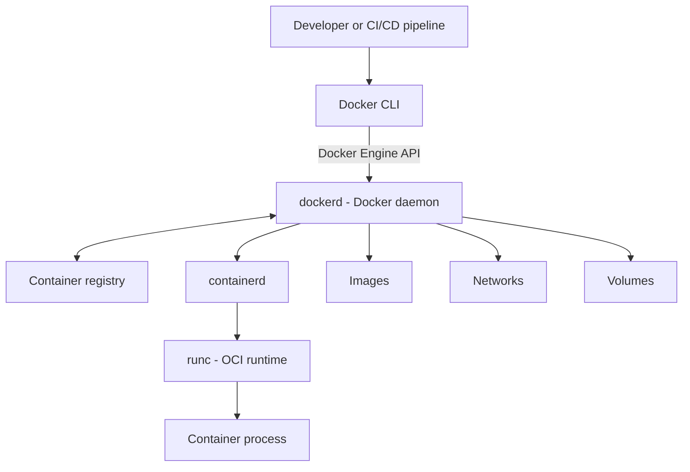

# Docker Architecture Diagram

This diagram shows a simplified view of the common Docker Engine client-server architecture.

## Explanation

1. A user or pipeline invokes the Docker CLI.
2. The CLI sends a request to the Docker Engine API.
3. The Docker daemon handles the request and manages Docker resources.
4. For image operations, the daemon may communicate with a registry.
5. For container execution, Docker coordinates with containerd.
6. containerd invokes an OCI runtime such as runc to create and start the container process.

## Important notes

- The diagram is conceptual and omits implementation details such as containerd shims, plugins, snapshots, and operating-system-specific layers.
- Docker Desktop commonly runs the Linux Engine inside a managed Linux environment on Windows or macOS.
- A registry is involved when an image needs to be pulled or pushed; a locally available image can be used without a registry request.
