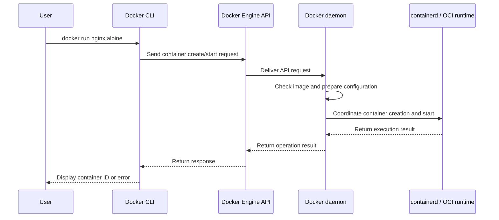

# Docker Client-Server Communication

Docker uses a client-server model. The CLI is a client of the Docker Engine API, and the daemon provides the API.



## Local communication

On many Linux systems, the CLI communicates with the daemon over a Unix socket:

```text
/var/run/docker.sock
```

The exact endpoint depends on the Docker context and configuration.

## Remote communication

A Docker client can connect to a remote daemon using a configured context and a secured transport. Remote daemon access must be protected with appropriate authentication, encryption, network controls, and least-privilege access.

## Inspect contexts

```bash
docker context ls
docker context show
docker context inspect
```

Before running commands, confirm that the active context points to the intended Docker host.
