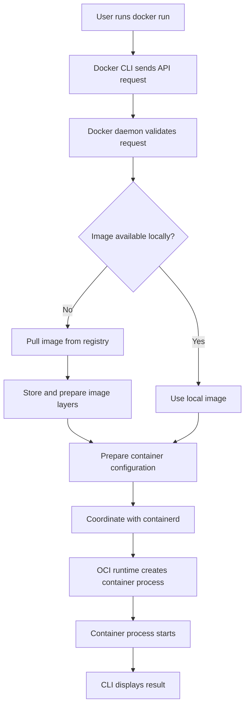

# Image-to-Container Flow

This diagram shows a simplified flow for starting a container from an image.



## Example command

```bash
docker run -d --name web-demo -p 8083:80 nginx:alpine
```

## What happens?

- Docker checks the requested image reference.
- If the image is not present locally, Docker pulls it from the configured registry.
- The image is prepared from its layers.
- Docker creates a container configuration, including the name and port mapping.
- The runtime stack creates and starts the container process.
- Docker reports the container ID to the CLI.

## Verify the result

```bash
docker ps
docker image ls
docker logs web-demo
```

Clean up:

```bash
docker rm -f web-demo
```

This removes the demo container, not the image.
