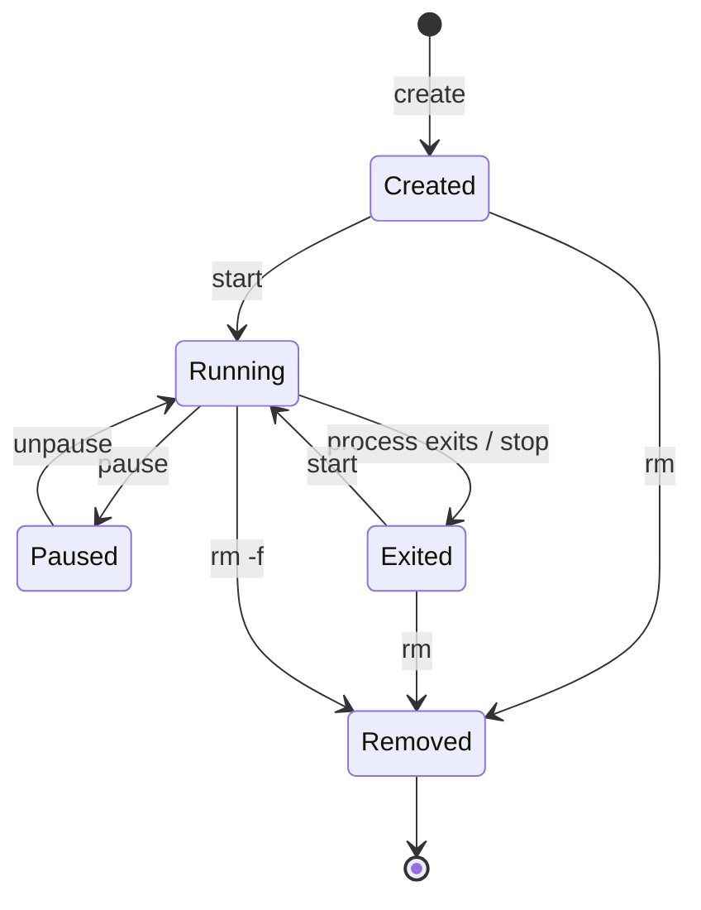

# Docker Container Lifecycle

A container is a runnable instance of an image. Its lifecycle depends on the main process and the commands used to manage it.

## Simplified lifecycle



## Common commands

Create and start a container:

```bash
docker run -d --name web-demo -p 8084:80 nginx:alpine
```

List running containers:

```bash
docker ps
```

List all containers:

```bash
docker ps -a
```

Stop and start:

```bash
docker stop web-demo
docker start web-demo
```

Restart:

```bash
docker restart web-demo
```

Remove a stopped container:

```bash
docker rm web-demo
```

Force-remove a running or stopped container:

```bash
docker rm -f web-demo
```

Use force removal only when you intend to stop and remove that container.

## Important concepts

- A container usually runs while its configured main process is running.
- When the main process exits, the container enters the exited state.
- Stopping a container does not normally delete it.
- Removing a container does not automatically remove named volumes.
- A container's writable layer is not a replacement for persistent storage.

## Exercise

Run an Nginx container, stop it, inspect it with `docker ps -a`, start it again, and finally remove it.
