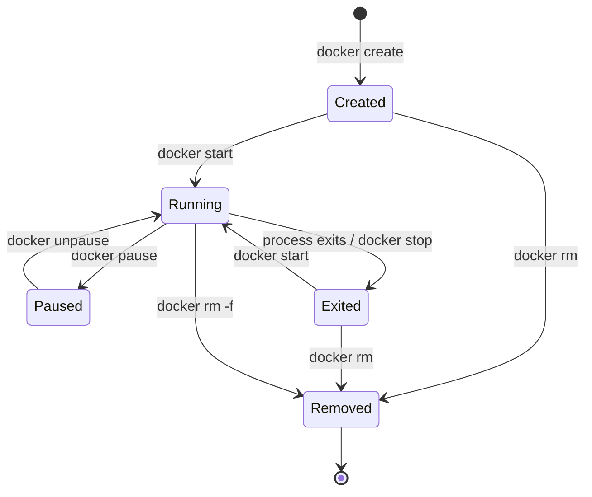

# Container Lifecycle

A container moves through states as it is created, started, stopped, and removed.



## Try the lifecycle

```bash
# Create a container without starting it
docker create --name lifecycle-demo nginx:alpine

# Check its state
docker ps -a

# Start it
docker start lifecycle-demo

# Stop it
docker stop lifecycle-demo

# Start it again
docker start lifecycle-demo

# Remove it after stopping
docker stop lifecycle-demo
docker rm lifecycle-demo
```

## Key points

- `docker create` creates a container but does not start it.
- `docker run` is commonly used to create and start a container in one command.
- `docker stop` asks the main process to stop gracefully, then forcefully terminates it after the configured timeout if necessary.
- `docker rm` removes a stopped container.
- `docker rm -f` force-stops and removes a container.
- A container exits when its main process exits.

A stopped container can be started again, but changes in its writable layer remain associated with that same container until it is removed.
